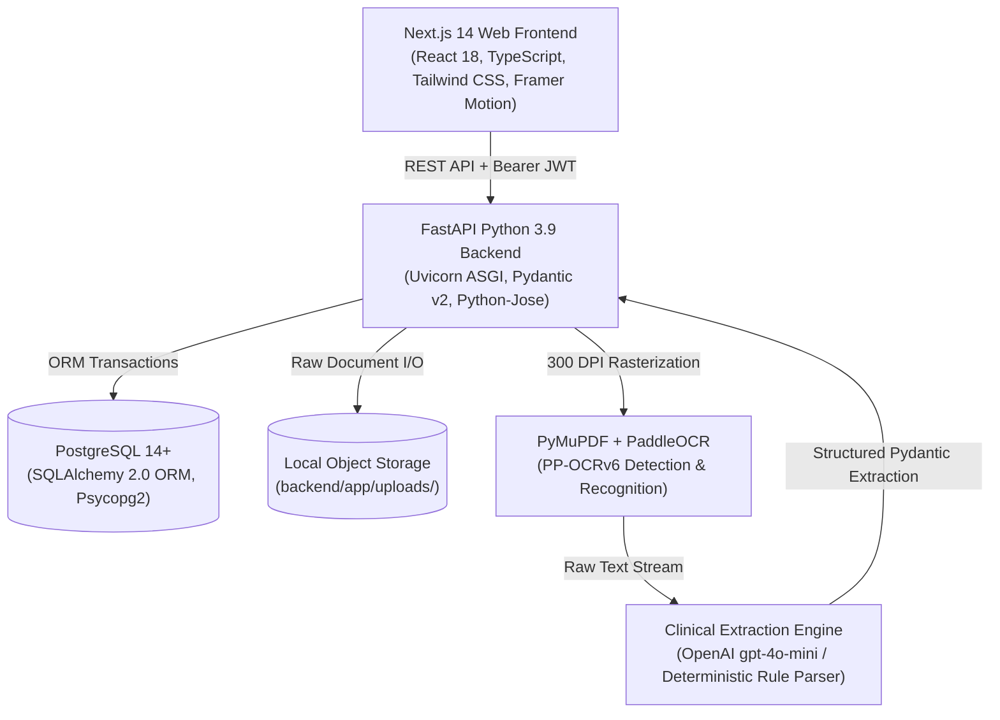
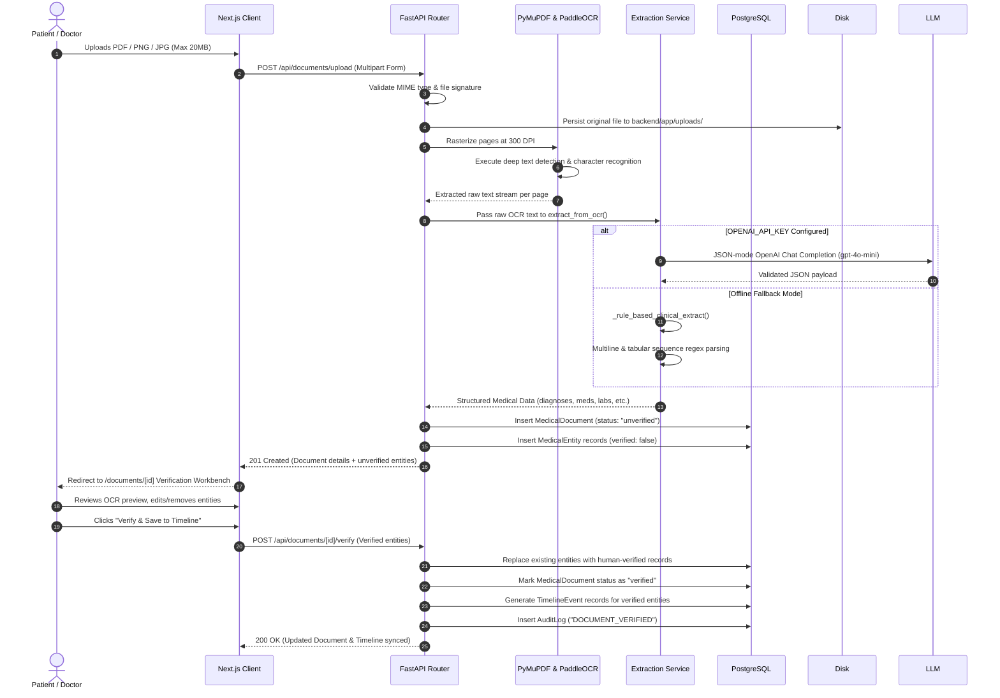
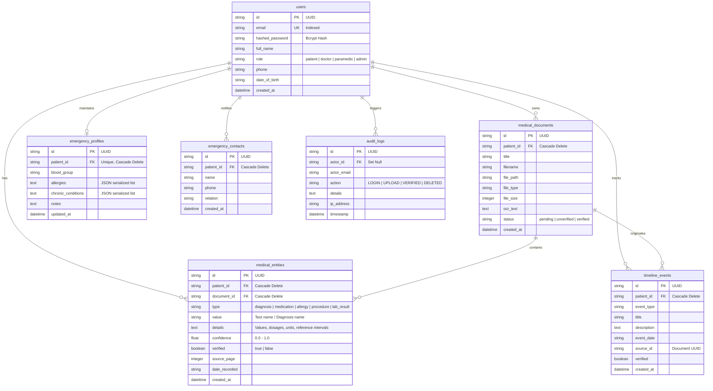

# MedSync Clinical OS — Technical Architecture & Implementation Manual

## 1. Executive System Overview
**MedSync Clinical OS** is a high-reliability, zero-hallucination healthcare intelligence platform designed to eliminate clinical data fragmentation. It bridges physical medical paperwork (discharge summaries, laboratory reports, handwritten prescriptions, pathology panels) and longitudinal electronic health trajectories through an automated **OCR → Clinical Entity Extraction → Human-in-the-Loop Verification → Longitudinal Timeline** pipeline.

### Core Engineering Principles
1. **Zero Hallucination Guarantee:** The system never infers diagnoses or invents medications. Extractions must be grounded directly in explicitly observed OCR text.
2. **Deterministic Fallback Capability:** Can operate 100% offline without external LLM dependencies, running deep learning OCR (PaddleOCR) and medical pattern extraction locally on the host machine at zero operational token cost.
3. **Strict Human Verification (HITL):** Clinical data extracted from documents remains in an `unverified` quarantine state until explicitly reviewed, corrected, and committed by a human clinician or patient.
4. **Longitudinal Synthesis:** Verified medical records automatically materialize into an interactive chronological trajectory grouped by year and category.
5. **Fail-Safe Emergency Access:** Dedicated paramedic emergency portal providing sub-second access to blood type, critical allergies, chronic conditions, and emergency contacts.

---

## 2. Technology Stack Architecture



| Layer | Technology | Version / Spec | Purpose & Implementation Details |
| :--- | :--- | :--- | :--- |
| **Frontend Framework** | **Next.js** | `14.2.35` (App Router) | Server-side rendering, React client components, route handlers, route middleware guards. |
| **Language** | **TypeScript** | `5.x` | Strict type checking across API clients, data models, state, and UI props. |
| **Styling & Design** | **Tailwind CSS** | `3.4.1` | Dark-first luxury clinical interface (inspired by 21st.dev, Apple, Linear, Vercel). |
| **Motion & Micro-interactions** | **Framer Motion** | `11.x` | Smooth page transitions, collapsible timeline event accordions, animated modals. |
| **Icons & Typography** | **Lucide React** + **Inter/Poppins** | `0.344.0` | Clinical domain icons, typography tracking, high-contrast monospace numeric badges. |
| **Backend Framework** | **FastAPI** | `0.115.x` | Asynchronous Python REST API with dependency injection, auto-generated OpenAPI/Swagger docs. |
| **ASGI Server** | **Uvicorn** | `0.34.x` | High-throughput asynchronous server running with hot-reload support on port `8001`. |
| **Database & ORM** | **PostgreSQL** + **SQLAlchemy** | `2.0.38` | Relational storage for users, documents, entities, timeline events, and audit logs. |
| **Validation Layer** | **Pydantic** | `2.10.x` | Request/response data serialization, input sanitization, and extraction schema validation. |
| **Document Rasterization** | **PyMuPDF (`fitz`)** | `1.25.x` | Vector PDF rasterization rendered at 300 DPI into high-resolution RGB pixmaps. |
| **OCR Engine** | **PaddleOCR / PaddlePaddle** | `3.x / 2.6.x` | Deep-learning optical character recognition using cached models (`PP-OCRv6_medium`). |
| **Auth & Security** | **Bcrypt** + **Python-Jose** | `4.0.1 / 3.3.0` | Salted password hashing (`bcrypt`) and stateless HS256 JWT access tokens. |

---

## 3. End-to-End Clinical Processing Flow



---

## 4. Database Schema Architecture

The relational database layer is managed through SQLAlchemy with Foreign Key cascade constraints ensuring referential integrity upon deletion.



---

## 5. Optical Character Recognition (OCR) Engine

The document processing pipeline replaces mocked heuristics with a strict local OCR engine configured in `backend/app/services/ocr_service.py`.

### Technical Pipeline:
1. **Format Validation:** Rejects unapproved formats at upload time. Allowed formats: `.pdf`, `.png`, `.jpg`, `.jpeg`. Maximum payload size: `20 MB`.
2. **High-Resolution Rasterization:** For PDF files, PyMuPDF (`fitz`) renders each page at **300 DPI** using a scale matrix (`fitz.Matrix(300/72, 300/72)`), converting vector glyphs and scanned text into sharp uncompressed RGB images.
3. **Deep Learning Text Detection & Recognition:**
   - Powered by **PaddleOCR (`PP-OCRv6`)**.
   - Model weights are cached locally inside the workspace at `.paddlex/` and `.paddle/` to prevent external download latency or permission errors during execution.
   - Text boxes are sorted in top-to-bottom reading order.
4. **Structured Output:** Aggregates line text, word tokens, and page numbers, returning both a full textual stream and structured page metadata used for bounding-box source attribution.

---

## 6. Clinical Extraction & Pathology Extraction Engine

The clinical extraction system in `backend/app/services/extraction_service.py` is engineered for strict clinical accuracy.

### Extraction Rules:
- **Never Infer Diagnoses:** Document headers such as `HAEMOGRAM (CBC)`, `COMPLETE BLOOD COUNT`, or `Pathology Report` are strictly blacklisted from being extracted as clinical diagnoses.
- **Never Invent Medications:** Prescriptions must specify observed drug names and extracted dosages/frequencies without synthetic generation.
- **Complete Laboratory Extraction:** For pathology panels (Complete Blood Count, Metabolic Panels, Lipid Profiles), every measurable test row is extracted as a `lab_result` entity.

### Pathology Tabular Sequence Parsing:
OCR engines frequently segment table rows into independent vertical text lines rather than a single space-delimited string. The extraction engine supports both:
1. **Single-Line Tables:** `<Test Name> <Value> <Unit> <Biological Reference Interval>`
2. **Multiline Tabular Sequences:** Sequentially matching consecutive OCR bounding box outputs:
   - Line 1: `Haemoglobin`
   - Line 2: `13.6`
   - Line 3: `g/dL`
   - Line 4: `12.0 - 15.0`
3. **Comma-Formatted Numerics:** Supports standard clinical counts (e.g., Platelets `250,000 /cumm`, WBC `4,000 - 11,000 /cumm`).
4. **Metadata Filtering:** Ignores document metadata lines (`DOB/Age/Sex`, `Sample ID`, `Referred By`, `Registered On`) to prevent administrative labels from turning into medical observations.

---

## 7. Security, Authentication & Role-Based Access Control (RBAC)

Authentication is decoupled from frontend state and strictly enforced by the backend database and Next.js middleware.

### Security Architecture:
- **Password Security:** Passwords hashed with `bcrypt` (work factor 12). Plaintext passwords are never stored or logged.
- **Access Tokens:** Stateless JSON Web Tokens (JWT) signed via HS256 containing user ID (`sub`), email, and `role`. Default expiration is 24 hours.
- **Next.js Middleware Guard (`frontend/src/middleware.ts`):** Intercepts navigation to protected dashboard paths (`/dashboard`, `/documents`, `/timeline`, `/doctor`, `/emergency`, `/audit`). Automatically redirects unauthenticated requests to `/login`.
- **Role Permissions:**
  - `patient`: Can view and manage their personal health documents, timeline records, and emergency profile. Blocked from accessing other patient files.
  - `doctor`: Accesses clinical review workbenches, search patient charts, inspects verified documents.
  - `paramedic`: Fast-path read-only access to emergency SOS profiles, blood group, allergies, and critical notes. Forbidden from modifying or deleting documents.
  - `admin`: System-level oversight, access to audit logs, and account provisioning.

---

## 8. Record Deletion & Data Lifecycle Engine

A complete deletion mechanism allows patients and doctors to manage medical privacy and purge inaccurate or obsolete clinical records.

```mermaid
graph TD
    Trigger["User requests deletion<br/>(DocumentCard / Document Detail / TimelineCard)"] --> Modal["Interactive Confirmation Modal<br/>(Displays target title & impact warning)"]
    Modal -->|Confirmed| API["DELETE /api/documents/{id}<br/>or DELETE /api/timeline/{id}"]
    API --> AuthCheck{"Authorization Check<br/>Owner or Doctor/Admin?"}
    AuthCheck -->|Forbidden| Err["403 Forbidden"]
    AuthCheck -->|Authorized| Cleanup["Execute Cascade Cleanup"]

    subgraph Cascade Cleanup
        Cleanup --> C1["Delete associated TimelineEvent records"]
        Cleanup --> C2["Delete associated MedicalEntity records"]
        Cleanup --> C3["Unlink/Remove physical file from uploads/"]
        Cleanup --> C4["Record HIPAA Audit Entry (DOCUMENT_DELETED)"]
        Cleanup --> C5["Commit Database Transaction"]
    end

    Cascade Cleanup --> Resp["200 OK + UI Optimistic State Update"]
```

### Deletion Capabilities:
1. **Document-Level Purge (`DELETE /api/documents/{document_id}`):**
   - Cascades deletion to all linked `medical_entities`.
   - Cleans up all timeline events generated from the document (`TimelineEvent.source_id == doc.id`).
   - Removes the raw rasterized file from the filesystem.
   - Logs `DOCUMENT_DELETED` in the audit log.
2. **Individual Clinical Record Purge (`DELETE /api/timeline/{record_id}`):**
   - Enables deleting a specific lab result, allergy, or medication directly from the timeline view without deleting the parent document.
   - Automatically synchronizes with emergency profiles and records an audit trail.

---

## 9. Frontend Architecture & Design System

The frontend is constructed using design tokens inspired by modern clinical interfaces:
- **Color Hierarchy:** Deep obsidian backgrounds (`#080C14`, `#0B0F19`), translucent surface cards (`bg-white/[0.02] border-white/[0.08]`), and clinical semantic accents:
  - Blue (`#2563EB`): Primary clinical actions and active navigational states.
  - Emerald (`#10B981`): Verified clinical records, normal lab ranges.
  - Amber (`#F59E0B`): Unverified entities requiring human review.
  - Red (`#EF4444`): Allergies, acute contraindications, emergency SOS.
- **Glassmorphism:** Navigation and modals leverage backdrop blur filters (`backdrop-blur-xl`).
- **Interactive Document Verification Workbench (`/documents/[id]`):**
  - **Left Pane:** Zoomable document preview supporting multi-page navigation and raw OCR text stream toggle.
  - **Right Pane:** Categorized entity editor displaying confidence badges, page attribution tags, and in-place field editing before committing to the timeline.

---

## 10. Local Development & Operational Verification

### Quick Start
To launch the complete MedSync Clinical OS locally:

```bash
# 1. Start all dev servers (FastAPI backend on 8001, Next.js frontend on 3000)
./start_dev.sh
```

### Service Endpoints
- **Frontend Application:** `http://localhost:3000`
- **Backend API & Health Check:** `http://localhost:8001`
- **Interactive OpenAPI Documentation:** `http://localhost:8001/api/docs`

### Seed Accounts (Pre-configured in Database)
- **Patient Account:** `patient@medsync.io` (Password: `password123`)
- **Doctor Account:** `doctor@medsync.io` (Password: `password123`)
- **Paramedic Account:** `paramedic@medsync.io` (Password: `password123`)
- **Admin Account:** `admin@medsync.io` (Password: `password123`)
